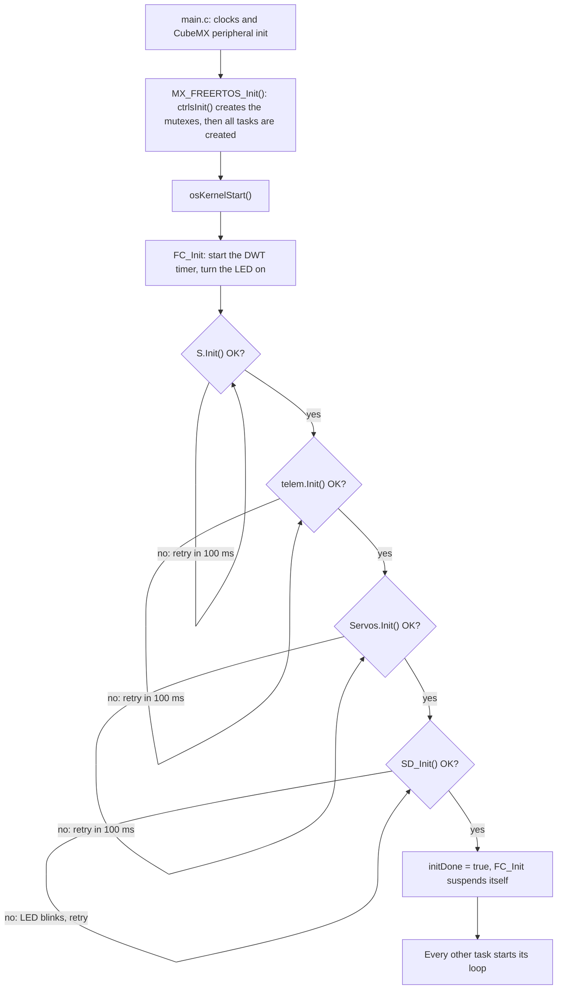
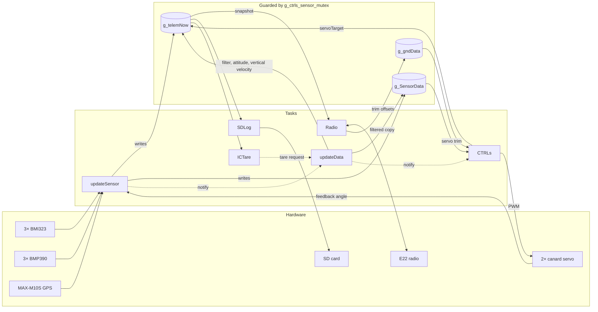
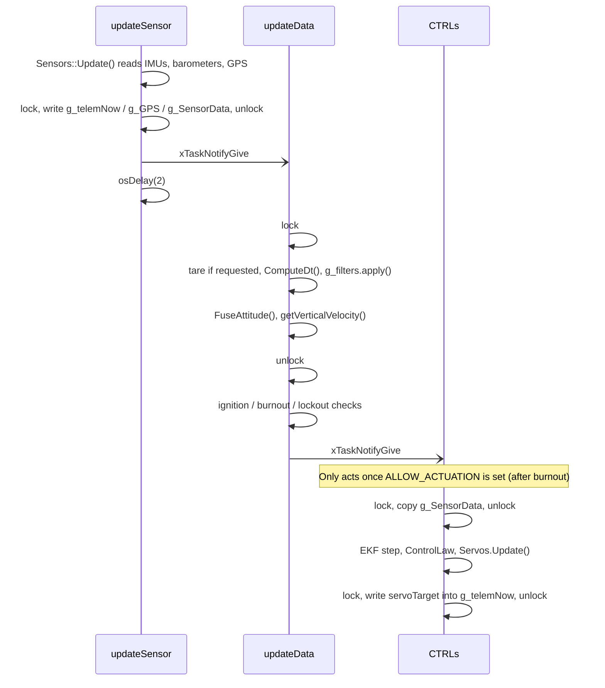
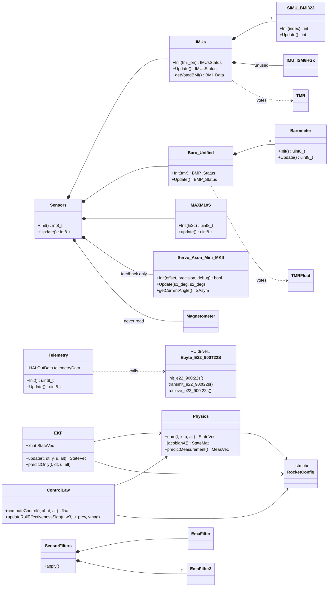
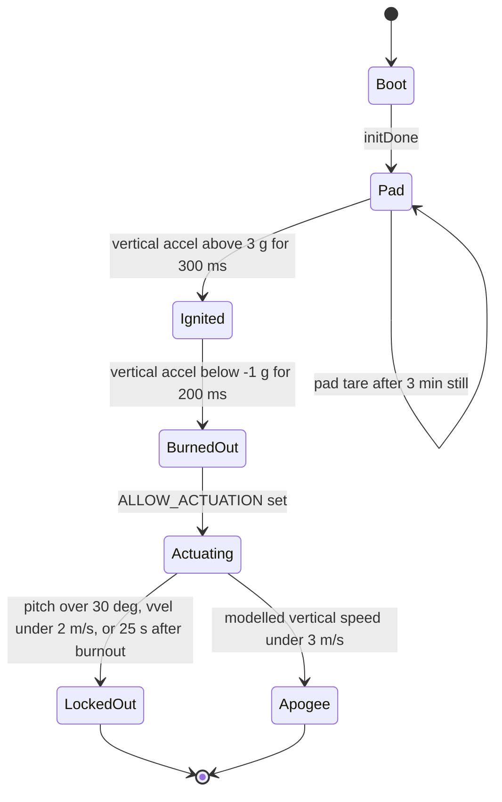

# HAL-1 Flight Software Architecture

HAL-1 is the flight computer for the Control Freak rocket. It runs on an
STM32H753 under FreeRTOS. It reads triple-redundant IMUs and barometers plus a
GPS, estimates attitude, drives two canards to damp roll after motor burnout,
logs to an SD card, and sends telemetry to the ground station over a 909 MHz
LoRa radio.

This page is the map: the hardware, the tasks, how data moves between them,
and how the classes fit together. Per-function details are in the Doxygen
comments in `Core/Inc/`; run `doxygen` from the repository root to browse them
as HTML (see [Building the docs](#building-the-docs)). Problems found while
writing this are listed under [Known issues](#known-issues).

All file references are to `main` at the time of writing.

## Hardware

| Part | Interface | Driver |
|---|---|---|
| STM32H753VIT6, Cortex-M7, 2 MB flash | | FreeRTOS via CMSIS-RTOS2 |
| 3× Bosch BMI323 IMU | SPI4, chip selects PE11 / PE9 / PE7 | `SIMU_BMI323`, voted by `IMUs` |
| 3× Bosch BMP390 barometer | SPI2, chip selects PD8 / PD10 / PD12 | `Barometer`, voted by `Baro_Unified` |
| u-blox MAX-M10S GPS | I2C4 (address 0x42), reset on PB5 | `MAXM10S` (NMEA via TinyGPSPlus) |
| ST LIS2MDL magnetometer | SPI1, chip select PD4 | `Magnetometer`. Initialized, never read. |
| ST ISM6HG256X high-g IMU | SPI3, chip select PD0 | `IMU_ISM6HGx`. Not used. |
| 2× Axon Mini MK2 canard servo | PWM on TIM3 CH1/CH2 (PC6/PC7), feedback on ADC3 (PC2/PC3) | `Servo_Axon_Mini_MKII` |
| EBYTE E22-900T22S LoRa radio | UART8, plus RST/AUX/M0/M1 on PE2–PE5 | `Ebyte_E22_900T22S` driver + `Telemetry` |
| SD card | SPI6, chip select PA4 | FatFs + `SDCard` |
| User LED | PD14 | Boot and radio status |

## Boot sequence

`main.c` (CubeMX) brings up the clocks and peripherals, then
`MX_FREERTOS_Init()` in `freertos.c` creates the mutexes and every task.
Only `FC_Init` does anything at first; all other tasks loop on
`osDelay(10)` until it sets `initDone`.



Each step retries forever. A missing SD card, a GPS that never answers, or
unattached servos stops the whole boot, so the radio never starts either. The
LED tells you where it stopped: solid means sensors, radio or servos; fast
blinking means the SD card.

## Tasks

| Task | Entry point | Priority | Stack | Runs | Job |
|---|---|---|---|---|---|
| defaultTask | `FC_Init()` | Normal | 4 KB | once | Initializes every subsystem, sets `initDone`, suspends. |
| updateSensor | `updateSensorTask()` | Realtime | 4 KB | every 2 ms | `Sensors::Update()`, then notifies updateData. |
| updateData | `updateDataTask()` | Realtime | 4 KB | on notify | Filters, attitude, vertical velocity, flight state machine. Notifies CTRLs. |
| CTRLs | `CTRLs()` | Realtime | 12 KB | on notify | After burnout: backup PID or the EKF state-space controller. Drives the servos. |
| Radio | `Radio()` | Realtime | 4 KB | continuous | Sends telemetry; opens a 2 s receive window every 5 s. |
| SDLog | `SDLogTask()` | AboveNormal | 2 KB | every 10 ms | Writes SENS1, SENS2 and GPS lines to the SD card. |
| ICTare | `Initial_Condition_Tare()` | BelowNormal | 512 B | every 100 ms | After 3 min of stillness, requests the pad tare, then suspends. |

The four Realtime tasks share one priority, so FreeRTOS time-slices between
them whenever more than one is ready. There are no queues or semaphores.
Tasks share data through globals guarded by one priority-inheritance mutex,
`g_ctrls_sensor_mutex`, and the sensor pipeline is chained with task
notifications.

## How data moves



One sensor frame, from read to canard command:



### Shared state

| Variable | Defined in | Written by | Read by | Protection |
|---|---|---|---|---|
| `g_telemNow` | FlightComputer_SENSORS.cpp | Sensors::Update, SensorFilters::apply, FuseAttitude, updateDataTask, CTRLs | Radio, SDLog, ICTare, CTRLs_PID, updateDataTask | mutex (updateDataTask reads its state-machine inputs without it) |
| `g_SensorData` | CTRLS_Controls.cpp | Sensors::Update, SensorFilters::apply | CTRLs_STATESPACE | mutex |
| `g_gndData` | FlightComputer_SENSORS.cpp | Telemetry::receiveCommands | CTRLs (servo trim) | mutex |
| `g_GPS` | FlightComputer_SENSORS.cpp | Sensors::Update | SDLog | written under the mutex, read without it |
| `g_alt_pad_m` | main.cpp | updateDataTask (tare) | Radio | none |
| `initDone`, `g_request_tare` | main.cpp | FC_Init, ICTare | every task, updateDataTask | volatile |
| `STATE_*`, `ALLOW_ACTUATION`, `g_ctrls_enabled` | main.cpp, CTRLS_Controls.cpp | updateDataTask, Telemetry, CTRLs | CTRLs | none |

`g_telemNow` keeps altitude as barometric altitude above sea level. The Radio
task subtracts the pad altitude recorded at the tare, so the transmitted
altitude is above ground level once the tare has run.

## Classes

`main.cpp` owns three global objects: `S` (Sensors), `telem` (Telemetry) and
`Servos` (the servos the controller drives). The controller objects are
function-local statics inside `CTRLs_STATESPACE()`.



Each sensor driver wraps a vendor library (Bosch BMI3/BMP3, ST
LIS2MDL/ISM6HG256X, TinyGPSPlus) through small platform files
(`BMI323_Platform`, `BMP3xx_platform`, `ISM6_Platform`) that adapt the
vendor's read/write/delay callbacks to the STM32 HAL.

Redundancy is two-out-of-three voting. `TMR::Vote()` (vectors) and
`TMRFloat::Vote()` (scalars) average the two readings that agree best and
discard the third.

## Flight state machine

`updateDataTask()` latches these states from the filtered vertical
acceleration (body Z, about +1 g at rest) and vertical velocity.



- The pitch lockout applies in every state, including on the pad. The tare
  clears it.
- The pad tare resets the attitude estimator, records the pad altitude, and
  resets the whole state machine, which includes clearing `g_ctrls_enabled`
  (see [Known issues](#known-issues)).
- Separately, `Sensors::Update()` starts the flight clock
  (`g_SensorData.flight_time_s`) when the total acceleration exceeds 3 g for
  200 ms. The EKF and controller use that clock.

### Which controller runs

| Condition | CTRLs task does |
|---|---|
| `ALLOW_ACTUATION` clear | Waits. The servos stay where `Servos.Init()` left them. |
| `ALLOW_ACTUATION` set, `STATE_BACKUP_PID` set (ignition never latched) | `CTRLs_PID()`: proportional roll damper, 0.30° per deg/s, ±7°. |
| `ALLOW_ACTUATION` set, `STATE_BACKUP_PID` clear | `CTRLs_STATESPACE()`, if `g_ctrls_enabled`. |

`CTRLs_STATESPACE()` runs an extended Kalman filter (`EKF`) over the 6-DOF
model in `Physics`, ported from the FV-Controls simulation. `ControlLaw` then
commands both canards to u = −K · s · ω3, where K = I3 · λ / (∂M/∂ζ) sets the
closed-loop roll pole and s is a ±1 sign that the roll effectiveness monitor
flips if the canards turn out to act backwards. The command is rate-limited
(about 429°/s), clamped to ±9°, and zero below 30 m/s and before burnout (IREC
rule). The vehicle parameters are in `loadControlFreakRocketConfig()`.

## Radio link

The FC and ground station use EBYTE E22-900T22S modules in fixed-point mode:
FC address 0x0706, GND address 0x4A4A, NETID 0xE6, channel 59 (909.125 MHz),
4.8 kbps air rate, 22 dBm. The MCU talks to the module over UART8 at 38400
baud (9600 while configuring it).

`Telemetry::Update()` runs a fixed duty cycle. Every 5 s it opens a receive
window of up to 2 s; the rest of the time each call sends one 112-byte
`telemetryData` packet. The ground station has to transmit inside that window
to be heard.

Frame layout, both directions:

| Bytes | Content |
|---|---|
| 0–2 | Target address and channel. The E22 strips these before transmitting. |
| 3–4 | Sync: 0xAA 0x55 |
| 5 | Payload length N |
| 6–7 | Sequence number, little-endian |
| 8 … 7+N | Payload: a raw copy of the struct, padding included |
| 8+N, 9+N | 16-bit byte sum of bytes 3 … 7+N, little-endian (not a CRC) |
| 10+N, 11+N | Sync: 0x55 0xAA |

On receive, the E22 appends one RSSI byte. Payloads are `telemetryData`
(N = 112, FC → GND) and `GndStationData` (N = 16, GND → FC). Both structs
must match HAL-1-GND byte for byte.

GND command byte 217 stops the controllers. Any other command byte is treated
as a channel change (see [Known issues](#known-issues)).

## SD card log

`HAL1_LOG.TXT` is opened in append mode. Each line starts with a tag and the
`HAL_GetTick()` time in ms:

| Tag | Written by | Fields |
|---|---|---|
| `SENS1` | SDLog, 100 Hz | lat, lon, baro altitude, GPS altitude, vertical velocity, temperature |
| `SENS2` | SDLog, 100 Hz | accel x/y/z, gyro x/y/z, roll, pitch, yaw, servo commands, RSSI, pyro flags |
| `GPS` | SDLog, 100 Hz | lat, lon, altitude, UTC hh:mm:ss, satellites, HDOP |
| `DYN` | CTRLs_STATESPACE, every 20 ms while active | flight time, model altitude, vertical and horizontal speed, roll rate |
| `EVENT` | CTRLs_STATESPACE | e.g. `ModelApogee` |

Every line is synced to the card as it is written, so the actual rate is
limited by the card.

## Source map

| Area | Files |
|---|---|
| Tasks and state machine | `Core/Src/main.cpp`, `Core/Src/freertos.c` (task creation), `Core/Src/interrupt_override.cpp` |
| Sensors | `FlightComputer_SENSORS`, `IMUs`, `SIMU_BMI323`, `BMI323_Platform`, `IMU_ISM6HGx`, `ISM6_Platform`, `Barometer`, `BMP390`, `BMP3xx_platform`, `LIS2MDL`, `MAXM10S` |
| Estimation | `FlightComputer_DATAUPDATE`, `DataFilter`, `CTRLS_SensorFusion` (EKF); attitude estimator in the `attitude_estimator` submodule |
| Controls | `CTRLS_Controls`, `CTRLS_ControlAlgorithm` |
| Actuation | `Servo_Axon_Mini_MKII` |
| Radio | `Telemetry`, `Ebyte_E22_900T22S`, `Ebyte_E22_900T22S_defs` |
| Platform | `constants.h`, `timing`, `SDCard`, `Math/*`, `TEST_FUNCTIONS` |
| CubeMX-generated | `main.c`, `freertos.c`, `gpio.c`, `spi.c`, `i2c.c`, `usart.c`, `tim.c`, `adc.c`, `stm32h7xx_it.c`, `Hal-1-SW.ioc`. Edit only inside `USER CODE` blocks, or in CubeMX. |
| Third-party | `bmi3*`, `bmp3*`, `ism6hg256x_reg*`, `lis2mdl_reg*`, `TinyGPSPlus*`, `Middlewares/`, `Drivers/`, `attitude_estimator/` |

These files are in the tree but not compiled: `Core/Src/Buzzer.cpp` and
`Core/Inc/Buzzer.h`, `Core/Src/Flight_Computer_State.cpp` (includes a header
that no longer exists), `Core/Src/Math/TMR.cpp` (a desktop test program with
its own `main()`), and the empty `Core/Inc/Initial_conditions.hpp`.

## Known issues

Found while writing these docs, by reading the code. None have been
reproduced on hardware. Each is also marked in the source, with `@bug`
(collected on Doxygen's Bug List page) or `@warning`.

| # | Severity | Issue | Where |
|---|---|---|---|
| 1 | High | The pad tare clears `g_ctrls_enabled`, and nothing sets it again (the only other writer, `Telemetry::processPyros()`, is never called). After a normal 3-minute wait on the pad, `CTRLs_STATESPACE()` returns at its first check, so the state-space controller never actuates. | `main.cpp` (tare), `CTRLS_Controls.h` |
| 2 | High | Any GND command byte other than 217 is treated as a channel change. The config write runs at 38400 baud, but the E22 only accepts config at 9600, so it fails and leaves the module in CONFIG mode. The radio stays down until reboot. | `Telemetry.cpp` `processCmd()`, `Ebyte_E22_900T22S.cpp` |
| 3 | High | Even a successful channel change is incomplete: `des_cfg.REG2` is never updated, so the config write repeats on every packet, and outgoing frames still name channel 909 in their header. | `Telemetry.cpp` |
| 4 | Medium | Receiving suspends the scheduler for up to 57 ms per attempt, and the 2 s receive window busy-waits at Realtime priority, so SDLog and ICTare get no CPU for 2 s out of every 5. | `Telemetry.cpp` |
| 5 | Medium | When `CTRLs_STATESPACE()` returns early, the CTRLs task calls it again immediately, so the task spins at Realtime priority while actuation is allowed but `g_ctrls_enabled` is clear. | `main.cpp` |
| 6 | Medium | `FC_Init()` retries every step forever, so one missing subsystem means no telemetry at all. | `main.cpp` |
| 7 | Medium | Servo S1 drives TIM3 CH1 (PC6, CubeMX name `SERVO2_PWM`) but reads feedback from PC2 (`SERVO1_ENC`), and S2 likewise. `Telemetry::receiveCommands()` swaps the GND trim offsets, probably to compensate. Check the PCB wiring. | `Servo_Axon_Mini_MKII`, `Telemetry.cpp` |
| 8 | Medium | The servo init check uses a 0.1° tolerance, about one ADC count, so it can fail on noise. With no servos attached it always fails and boot stops. | `main.cpp`, `Servo_Axon_Mini_MKII` |
| 9 | Medium | The EKF and controller pass barometric altitude above sea level to a weather table indexed by height above the launch site, so every weather lookup is offset by the site's elevation. | `CTRLS_Controls.h` (`altitude_m`) |
| 10 | Low | The backup PID's dead-band constant is in rad/s but compared with deg/s, so the dead-band is 0.017 deg/s instead of 1 deg/s. | `main.cpp` `CTRLs_PID()` |
| 11 | Check | In `FuseAttitude()`, the roll and yaw assignments contradict the comment above them. Spin the rocket on the bench and see which field moves. | `FlightComputer_DATAUPDATE.cpp` |
| 12 | Low | The commented-out body of `if (mag.Init() != 0)` makes that `if` guard the next statement, so `g_telemNow` is zeroed only when the magnetometer fails. | `FlightComputer_SENSORS.cpp` |
| 13 | Low | Telemetry fields that never carry data: the command echo (overwritten before sending), RSSI (never measured), and the pyro flags (never set). | `Telemetry.h` |
| 14 | Low | `Sensors` owns a second `Servo_Axon_Mini_MKII`. Both instances write TIM3 and share the feedback filter state. | `FlightComputer_SENSORS.h` |

Smaller leftovers: unused constants in `constants.h` (apogee, descent and
main-deploy thresholds, `COMMS_ERR_THRESHOLD`, `PYRO_MAIN_BIT`); unused
globals (`g_ctrls_test_mode`, `g_servoAngles`, `g_pyroPending`, `CTRLs_t`);
`SD_DynInit()` and `BMI_CS_Select()` / `BMI_CS_DeSelect()`, which are declared
but never defined; and stale comments describing an FC_MASTER/GND_MASTER radio
scheme that no longer exists.

## Building, flashing and docs

Build with the CMake presets. You need `arm-none-eabi-gcc`, CMake and Ninja,
and the `attitude_estimator` submodule:

```sh
git submodule update --init
cmake --preset Debug && cmake --build --preset Debug
```

Flash through an ST-LINK (a Nucleo board's on-board ST-LINK works, with its
two ST-LINK jumpers removed):

```sh
openocd -f board/st_nucleo_h743zi.cfg -c "program build/Debug/Kingfisher-SW.elf verify reset exit"
```

### Building the docs

The generated HTML is committed in `docs/doxygen/html`, so you can read it
without installing anything but Python 3:

```sh
python3 docs/view_docs.py          # Linux / macOS
py docs\view_docs.py               # Windows
```

It serves the docs on a local port and opens your browser. Add `--build` to
regenerate them with Doxygen first.

To regenerate them yourself, install Doxygen and Graphviz, then run `doxygen`
from the repository root, and commit the changes under `docs/doxygen/html`
along with the code changes. Doxygen runs silently; warnings go to
`docs/doxygen-warnings.log`, which should stay empty. The HTML includes call
and caller graphs for every documented function.

The diagrams on this page are Mermaid. They render on GitHub, and recent
Doxygen versions (1.18 here) render them in the HTML by loading mermaid.js
from a CDN, so that needs an internet connection. Older Doxygen versions
show them as code blocks, and editor previews may need a Mermaid plugin.

### Writing doc comments

Document the declaration in the header, not the definition. Use this style:

```cpp
/**
 * @brief One sentence that says what it does.
 *
 * Anything a caller needs: units, blocking behaviour, which task calls it,
 * which mutex it needs.
 *
 * @param name What it is, with units.
 * @return What each value means.
 * @warning Hazards for callers.
 * @bug Known defects, so they show up on the Bug List page.
 */
```

Use `///<` after a field or enumerator for a one-line description, and give
each new header a `@file` block with an `@ingroup` (the groups are defined in
`docs/groups.dox`).

Two Doxygen quirks to watch for:

- A `///<` comment documents only the last name in `float a, b, c;`. Wrap
  such a line in `///@{` and `///@}` so the comment covers every name.
- Don't put a `///` line directly under a `///<` comment. Doxygen joins
  them and the field loses its one-line summary. Leave a blank line between
  them; a closing `///@}` is fine.
